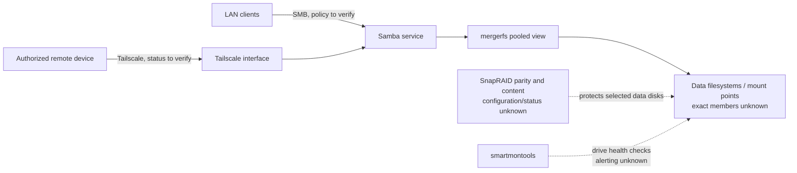

# Debian 13 NAS | Storage Infrastructure

> A headless home NAS documented as a practical systems administration project.

This repository describes a Debian 13 storage server built around an **OptiPlex 3090 Tower**. The project context identifies **SnapRAID**, **mergerfs**, **Samba**, **smartmontools**, and **Tailscale** as components of the design. This document deliberately distinguishes those reported project components from details that have not yet been verified from the host.

## Project at a glance

| Area | Current record |
|---|---|
| Platform | Dell OptiPlex 3090 Tower |
| Operating system | Debian 13, headless |
| Hostname | `nasjason` (earlier reference: `nasjson`; verify the active hostname) |
| Storage | Mixed drives; PCIe SATA expansion card reported |
| Storage services | SnapRAID and mergerfs are part of the project context; deployed configuration and health are unverified |
| File sharing | Samba is part of the project context; share definitions and access controls are unverified |
| Remote access | Tailscale is part of the project context; device status and ACL posture are unverified |
| Monitoring | smartmontools is part of the project context; schedule and alert delivery are unverified |

## Architecture

This is a conceptual diagram, not a verified live topology. SnapRAID parity is not real-time RAID and does not replace backups. mergerfs combines directory trees for convenient access; it does not provide redundancy by itself. See [storage notes](docs/storage.md).

## Documentation

- [Architecture and project status](docs/architecture.md)
- [Hardware, storage, and recovery notes](docs/storage.md)
- [Network and security](docs/network-security.md)
- [Setup and verification workflow](docs/setup.md)
- [Troubleshooting](docs/troubleshooting.md)
- [Sanitized examples](examples/README.md)

## Known facts and open verification

Known from the supplied project context: Debian 13 headless NAS, Dell OptiPlex 3090 Tower, hostname reported as `nasjason` (with an earlier `nasjson` spelling), Tailscale, SnapRAID, mergerfs, Samba, smartmontools, configured mount points and pools, mixed drives, and a PCIe SATA expansion card.

The source conversation available for this handoff does not provide actual disk models/capacities/counts, filesystem UUIDs, mount paths, mergerfs branch order/options, SnapRAID parity/content paths, Samba shares/users, network ranges, backup policy, monitoring alerts, or validation output. Those remain explicitly **unknown** here. Fill them from the running host before presenting this as a completed configuration. Do not publish IP addresses, serials, usernames tied to private accounts, keys, or credentials.

## Scope and safety

This repository is documentation, not a deployable automation bundle. Files under `examples/` contain placeholders and are not ready to apply. Validate device identity, mount behavior, parity state, permissions, and backups before making storage changes. Never run a parity sync after an unreviewed disk or configuration change.

## Resume summary (edit to match verified work)

> Built and documented a headless Debian 13 NAS on a Dell OptiPlex 3090 Tower, integrating a pooled storage design with mergerfs and SnapRAID, SMB file sharing, remote access through Tailscale, and SMART-based drive monitoring. Validated configuration, recovery procedures, and security controls. *(Keep claims only after confirming the corresponding work and evidence.)*

## License

Choose a license before publishing. For hardware and configuration documentation, a permissive license such as MIT is common, but the repository owner should select the terms.
